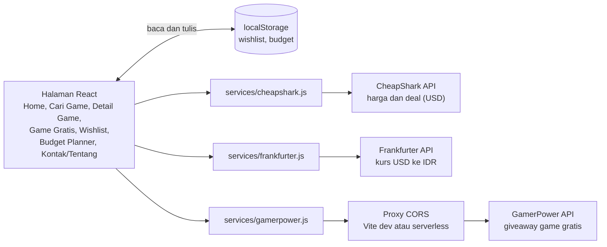

# PRD Gamer Wallet TZY

Terakhir diperbarui: 22 Oktober 2026

## Ringkasan

Gamer Wallet TZY adalah aplikasi web yang membantu gamer Indonesia memutuskan kapan dan di mana membeli game PC dengan harga terbaik, dengan harga dalam rupiah dan perencanaan budget bulanan. Pengguna mencari game, membandingkan harga antar toko, menyimpan game ke wishlist, lalu melihat berapa bulan uang jajan game dibutuhkan untuk membelinya. Halaman terpisah menampilkan game gratis yang sedang dibagikan, supaya pengguna tidak membeli game yang sebentar lagi gratis.

Aplikasi dibuat dengan React oleh tim 6 orang untuk tugas besar Perancangan dan Pemrograman Web. Tidak ada backend: data harga dan giveaway datang dari tiga API publik, dan data pengguna disimpan di localStorage.

## Latar belakang dan masalah

Gamer dengan uang jajan terbatas sulit memutuskan kapan sebuah game layak dibeli. Ada empat masalah yang ingin diselesaikan:

- Harga dari sumber data seperti CheapShark berbentuk USD, sehingga pengguna harus menghitung sendiri ke rupiah.
- Harga dan diskon berbeda antar toko dan berubah cepat, jadi toko termurah hari ini sulit diketahui.
- Game yang dibagikan gratis sementara mudah terlewat, dan ada pengguna yang membeli game yang tak lama kemudian gratis.
- Tidak ada patokan kapan wishlist bisa terbeli dari uang jajan bulanan.

## Tujuan dan indikator keberhasilan

Proyek berhasil jika pengguna bisa menemukan harga terbaik, merencanakan pembelian, dan tidak melewatkan game gratis, dan jika tim memenuhi rubrik tugas besar.

| Tujuan | Indikator keberhasilan |
| --- | --- |
| Menemukan harga terbaik | Detail game menampilkan harga di semua toko, diurutkan dari termurah, dalam rupiah |
| Merencanakan pembelian | Budget Planner menampilkan total wishlist dan estimasi bulan menabung dari uang jajan yang diisi |
| Tidak melewatkan game gratis | Halaman Game Gratis menampilkan giveaway aktif dan bisa difilter per platform |
| Memenuhi rubrik tugas besar | Ada validasi form, loading dan error state, komponen reusable, aksesibilitas, dan data API tampil di halaman |
| Kerja tim rapi | Minimal 15 commit di repository, target 3 commit atau lebih per anggota, semua lewat pull request |

## Target pengguna

Pengguna utama adalah gamer PC di Indonesia, terutama pelajar dan mahasiswa yang punya uang jajan game terbatas dan membeli game lewat toko digital.

Contoh persona: Rafi, mahasiswa yang bermain di PC. Ia ingin:

- melihat harga game langsung dalam rupiah,
- tahu toko mana yang paling murah hari ini,
- tahu kapan wishlist-nya bisa terbeli dari uang jajan bulanan,
- tidak ketinggalan game yang sedang dibagikan gratis.

## Ruang lingkup

Versi pertama mencakup tujuh halaman dan tiga API, tanpa akun pengguna dan tanpa backend.

| Termasuk | Tidak termasuk |
| --- | --- |
| Tujuh halaman: Home, Cari Game, Detail Game, Game Gratis, Wishlist, Budget Planner, Kontak/Tentang | Login, akun pengguna, dan database |
| Harga game PC dari CheapShark, ditampilkan dalam rupiah | Pembelian langsung di aplikasi |
| Wishlist dan budget tersimpan di localStorage | Notifikasi harga atau email pengingat |
| Tampilan responsif untuk HP dan laptop | Game konsol dan platform di luar data CheapShark |
| Antarmuka berbahasa Indonesia | Pilihan bahasa lain dan mode offline |

## Kebutuhan fungsional

Setiap halaman punya satu tujuan pengguna dan kriteria penerimaan yang bisa dicek anggota tim saat review pull request.

| Halaman | Sebagai pengguna, saya ingin... | Kriteria penerimaan |
| --- | --- | --- |
| Home | melihat deal terbaik hari ini dan ringkasan game gratis | Deal teratas dari CheapShark tampil sebagai kartu dengan harga rupiah dan badge diskon. Beberapa giveaway terbaru dari GamerPower tampil di bawahnya. Jika satu API gagal, bagian lain tetap tampil. |
| Cari Game | mencari game dan menyaring hasilnya | Pencarian berdasarkan judul, filter rentang harga dan toko, pencarian menunggu pengguna berhenti mengetik sebelum memanggil API, dan ada tampilan khusus saat hasil kosong. |
| Detail Game | membandingkan harga antar toko | Harga di setiap toko dalam rupiah, diurutkan dari termurah, dengan harga normal dan harga diskon. Ada tombol tambah dan hapus wishlist. |
| Game Gratis | melihat game yang sedang dibagikan gratis | Daftar giveaway aktif, filter platform dan tipe, dan atribusi GamerPower di footer. |
| Wishlist | menyimpan game yang ingin dibeli | Daftar game tersimpan, total harga dalam rupiah, hapus item, data tetap ada setelah halaman dimuat ulang, dan bisa dioperasikan dengan keyboard. |
| Budget Planner | tahu berapa bulan menabung untuk wishlist | Form uang jajan per bulan (wajib diisi, angka lebih dari 0), pesan error di bawah field, dan hasil berupa total wishlist serta estimasi bulan menabung. |
| Kontak/Tentang | menghubungi tim dan tahu sumber data | Form nama, email, dan pesan dengan validasi, pesan sukses setelah dikirim (disimulasikan, tanpa backend), serta info tim dan sumber data. |

Estimasi bulan menabung dihitung dengan rumus berikut, dibulatkan ke atas. Jika wishlist kosong, hasilnya 0.

```math
\text{bulan menabung} = \left\lceil \frac{\text{total wishlist (Rp)}}{\text{uang jajan per bulan (Rp)}} \right\rceil
```

## Kebutuhan non-fungsional

Bagian ini sekaligus menjadi checklist rubrik tugas besar.

- **Loading dan error state:** setiap pemanggilan API punya skeleton saat memuat dan pesan error dengan tombol coba lagi. Kegagalan satu API tidak boleh mengosongkan seluruh halaman.
- **Validasi form:** Budget Planner dan Kontak memvalidasi input sebelum diproses dan menampilkan pesan error yang jelas.
- **Komponen reusable:** kartu game, badge diskon, label harga rupiah, serta komponen loading dan error dipakai di lebih dari satu halaman.
- **Aksesibilitas:** seluruh fitur utama bisa dioperasikan dengan keyboard, setiap field form punya label, dan gambar punya teks alternatif.
- **Responsif:** tampilan nyaman di layar HP dan laptop.
- **Performa:** kurs USD ke IDR disimpan sementara di memori karena hanya berubah harian, dan pencarian tidak memanggil API di setiap ketikan.
- **Kejujuran data:** harga rupiah ditandai sebagai perkiraan beserta tanggal kurs, karena dihitung dari kurs Bank Sentral Eropa, bukan kurs toko.

## Arsitektur teknis

Aplikasi berupa single-page app React yang dibangun dengan Vite, memakai React Router untuk perpindahan halaman. Halaman tidak memanggil API langsung: semua pemanggilan lewat fungsi di folder `services`, sehingga format URL dan penanganan error hanya ada di satu tempat.



Halaman hanya berbicara dengan folder services, dan hanya GamerPower yang melewati proxy karena masalah CORS.

| API | Fungsi | Catatan |
| --- | --- | --- |
| CheapShark | Harga dan deal game PC (USD) | Tanpa API key. Endpoint yang dipakai: `/deals`, `/games`, `/stores`. Dokumentasi di apidocs.cheapshark.com. |
| Frankfurter | Kurs USD ke IDR | Tanpa API key, data Bank Sentral Eropa, diperbarui harian. Cek versi API di frankfurter.dev sebelum menulis service. |
| GamerPower | Giveaway game gratis | Tanpa API key, wajib mencantumkan GamerPower sebagai sumber di footer. CORS kemungkinan diblokir, jadi lewat proxy. |

Sebelum mulai coding, ketiga API dites dengan `fetch` dari DevTools console browser untuk memastikan mana yang butuh proxy.

**Data di localStorage.** Wishlist menyimpan ID game, judul, gambar, dan harga terakhir dalam USD. Harga rupiah dihitung saat ditampilkan supaya selalu mengikuti kurs terbaru. Budget menyimpan satu angka uang jajan per bulan.

**Struktur folder.**

```text
src/
  components/   GameCard, DiscountBadge, PriceIDR, Loading, ErrorState
  pages/        Home, Search, GameDetail, FreeGames, Wishlist, Budget, About
  services/     cheapshark.js, frankfurter.js, gamerpower.js
  hooks/        useWishlist, useBudget, useExchangeRate
  utils/        formatRupiah, hitungBulanMenabung
  App.jsx       routing
```

## Risiko dan mitigasi

Risiko terbesar adalah CORS pada GamerPower, karena bisa mengosongkan halaman Game Gratis.

| Risiko | Dampak | Mitigasi |
| --- | --- | --- |
| `fetch` ke GamerPower diblokir browser (CORS) | Halaman Game Gratis dan ringkasan di Home kosong | Proxy di dev server Vite saat development, serverless function (Vercel atau Netlify) saat deploy. Cadangan terakhir: salinan JSON di folder project yang tetap di-fetch. |
| Frankfurter punya lebih dari satu versi API | Format URL salah dan kurs tidak terbaca | Baca dokumentasi di frankfurter.dev dulu, dan hanya satu fungsi di `services/frankfurter.js` yang memanggilnya. |
| CheapShark lambat atau gagal | Home dan Cari Game kosong | Skeleton, pesan error dengan tombol coba lagi, dan pencarian yang menunggu pengguna berhenti mengetik. |
| Konflik git di `App.jsx`, routing, dan style global | Merge conflict yang menghambat 6 anggota | Kerangka project di-push ke `main` lebih dulu, satu orang pemilik routing, branch per fitur, pull request wajib. |
| Kurs ECB berbeda dari kurs toko | Harga rupiah sedikit meleset | Tampilkan label perkiraan dan tanggal kurs di setiap harga rupiah. |

## Pembagian tugas

Setiap anggota memegang satu halaman utama ditambah satu paket service, hook, atau komponen. Bebannya merata, dan tiap orang punya area kode sendiri sehingga konflik git berkurang.

| Anggota | Peran | Halaman | Service, hook, dan komponen |
| --- | --- | --- | --- |
| Rifky | Koordinator, detail, dan wishlist | Detail Game, Wishlist | Tabel harga antar toko, `useWishlist` (localStorage), tombol tambah dan hapus wishlist, review pull request |
| Affan | Data game | Cari Game | `services/cheapshark.js` (deals, games, stores), GameCard, DiscountBadge |
| Raken | Fondasi dan tampilan | Home | Setup Vite dan React, React Router, layout dan navbar, komponen Loading dan ErrorState, deploy |
| Ibnu | Budget dan kurs | Budget Planner | `services/frankfurter.js`, `useExchangeRate` (dengan cache), `formatRupiah`, PriceIDR, `useBudget`, `hitungBulanMenabung` |
| Fattan | Game gratis | Game Gratis | `services/gamerpower.js`, proxy CORS, filter platform dan tipe |
| Rosa | Kontak, footer, dan dokumentasi | Kontak/Tentang, halaman 404 | Validasi form Kontak, footer dengan atribusi GamerPower, README, pengecekan akhir responsif dan aksesibilitas |

**Urutan pengerjaan** supaya tidak saling menunggu:

1. Raken mengirim kerangka project ke `main` lebih dulu, termasuk layout, navbar, Loading, dan ErrorState, baru anggota lain membuat branch.
2. Service dikerjakan paling awal karena dipakai banyak halaman: `cheapshark.js` (Affan), `frankfurter.js`, `formatRupiah`, dan PriceIDR (Ibnu), `gamerpower.js` dan proxy (Fattan).
3. Rifky membuat `useWishlist` lebih dulu, lalu memakainya di Detail Game dan Wishlist. Ibnu memakai `useWishlist` untuk menghitung total di Budget Planner.
4. Rosa bisa langsung mulai dari Kontak/Tentang, halaman 404, dan footer karena tidak bergantung pada service lain.
5. Home (Raken) dirakit paling akhir karena memakai GameCard dari Affan dan data GamerPower dari Fattan.

Tiap anggota membuat minimal 3 commit lewat pull request sendiri, sehingga total commit melewati syarat 15.

## Alur kerja tim dan milestone

Branch `main` diproteksi: semua perubahan masuk lewat pull request yang di-review minimal satu anggota lain. Nama branch memakai pola `feat/nama-fitur`, dan pesan commit memakai awalan `feat:`, `fix:`, atau `style:`. Pembagian tugas per anggota ada di bagian Pembagian tugas.

**Definition of Done** untuk setiap fitur:

- [ ] Sesuai kriteria penerimaan di bagian Kebutuhan fungsional
- [ ] Ada loading state dan error state
- [ ] Tampil baik di layar HP dan laptop
- [ ] Bisa dioperasikan dengan keyboard
- [ ] Tidak ada error di console browser
- [ ] Pull request sudah di-review dan di-merge ke `main`

**Milestone** (tanggal diisi tim setelah tenggat tugas diketahui):

1. Fondasi: setup Vite dan React, routing, layout, tes ketiga API, proxy GamerPower, dan komponen dasar.
2. Halaman inti: Home, Cari Game, Detail Game, dan Game Gratis.
3. Fitur pengguna: Wishlist, Budget Planner, dan Kontak/Tentang.
4. Penyelesaian: aksesibilitas, responsif, state error, README, dan deploy.

## Pertanyaan terbuka

- [ ] Apakah setiap anggota setuju dengan pembagian tugasnya?
- [ ] Kapan tenggat tugas besar, dan apakah hasil akhir wajib di-deploy online?
- [ ] Styling memakai CSS biasa, CSS Modules, atau Tailwind?
- [ ] Proxy GamerPower cukup di dev server Vite, atau perlu serverless function agar jalan setelah deploy
